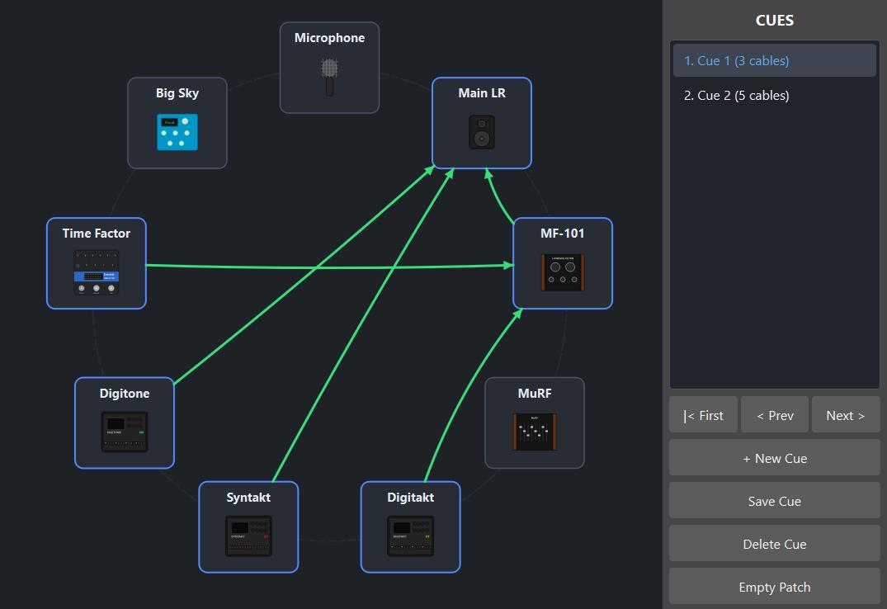

# Frangilive



Frangilive is a touch-friendly live audio patcher with cues for recalling your setup during a performance.

## Set up a fresh Raspberry Pi

Use **64-bit Raspberry Pi OS Bookworm or newer** with a graphical desktop and Internet access. The build is Linux ARM64 only; 32-bit Raspberry Pi OS is not supported. Open a terminal in the desktop session and install the host tools:

```bash
sudo apt update
sudo apt install jackd2 alsa-utils dbus-user-session libgl1 libegl1 libxkbcommon0 libxkbcommon-x11-0 libxcb-cursor0 libxcb-icccm4 libxcb-image0 libxcb-keysyms1 libxcb-render-util0 libxcb-xinerama0 libxcb-xkb1 curl unzip
```

During JACK installation, follow the realtime-priority prompt if offered. If you enable realtime scheduling, log out and back in so the audio group permissions take effect. Connect your audio and MIDI devices. The app currently searches for an ALSA audio interface containing **Fireface** in its name; check that it appears with:

```bash
aplay -l
command -v jack_control
```

The interface name is currently fixed in the application, not configurable in the UI. The app stops and reconfigures JACK at startup (ALSA, 48 kHz, 128 frames, three periods), so save work in other JACK applications first.

### Overwitch

Overwitch is needed for supported Elektron USB audio devices. For those devices, the repository's existing setup uses Overwitch 2.1. Install its build dependencies and build it separately from the packaged app:

```bash
sudo apt install git automake autoconf libtool libusb-1.0-0-dev libjack-jackd2-dev libsamplerate0-dev libsndfile1-dev autopoint gettext libsystemd-dev libjson-glib-dev build-essential pkg-config

cd ~
git clone https://github.com/dagargo/overwitch.git
cd overwitch
git checkout 2.2

autoreconf --install
CLI_ONLY=yes ./configure
make clean
make
sudo make install
sudo ldconfig

cd udev && sudo make install

cd ../systemd && sudo make install

systemctl --user daemon-reload
systemctl --user enable --now overwitch.service
```

Run the user service commands as your desktop user, not with `sudo`. Reconnect the device or reboot after installing the udev rules. Check `systemctl --user status overwitch.service` if it does not appear. Frangilive attempts to restart this service at startup; a warning is expected if Overwitch is not installed. See the [Overwitch project](https://github.com/dagargo/overwitch) for supported devices and troubleshooting.

## Download and run

The archive contains the application and native JACK matrix; Python, UV, a source checkout, and the repository's root scripts are not needed to run it.

1. Download `frangilive-linux-arm64.tar.gz` from the [latest release](https://github.com/MrFrangipane/frangilive/releases/latest), or run:

   ```bash
   curl -fL -o frangilive-linux-arm64.tar.gz https://github.com/MrFrangipane/frangilive/releases/latest/download/frangilive-linux-arm64.tar.gz
   ```

2. From a writable directory in your graphical desktop session, extract and run it:

   ```bash
   tar -xzf ~/Downloads/frangilive-linux-arm64.tar.gz
   ./frangilive-app/frangilive-app
   ```

   Adjust the archive path if you downloaded it elsewhere; for the `curl` command above, use the location where you ran it. Keep the entire extracted `frangilive-app` directory together. The app saves `cues.json` in the current working directory: always launch from the same directory and back up that file.

### Update

Remove the `frangilive-app` directory and download a new release.

```bash
rm -rf -d frangilive-app
```

### Download a GitHub Actions build

Open [Actions](https://github.com/MrFrangipane/frangilive/actions), select a successful **Build and release** run, and download the `frangilive-linux-arm64` artifact. GitHub may require you to sign in. Extract the downloaded ZIP to get `frangilive-linux-arm64.tar.gz`, then follow the extraction and launch steps above. Artifacts expire; tagged releases provide release assets instead.

## Using Frangilive

Drag between devices in the patcher to create connections. Use the **CUES** sidebar to create and save cues, select a cue, or move between cues during a performance. The app wires configured device ports through its JACK matrix and retries when ports appear.
